# Amazon Connect Contact Center Lab

## Overview

I built and tested a small inbound contact center in Amazon Connect. I created a cost guardrail, configured the core routing resources, published a two-option IVR flow, attached a Canadian phone number, completed a live agent call, and validated the result in contact records, queue metrics, and CloudWatch logs.

## Environment

| Component | Configuration |
| --- | --- |
| AWS account | Personal lab account |
| AWS Region | Canada Central, `ca-central-1` |
| Amazon Connect instance | `fadli-connect-lab` |
| Identity option | Users stored in Amazon Connect |
| Voice channel | Inbound calling |
| Queue | `Lab Support Queue` |
| Routing profile | `Lab Support Routing Profile` |
| Agent | Dedicated soft-phone agent user |
| Observability | Contact records, real-time metrics, historical metrics, and CloudWatch flow logs |

## Call-routing design

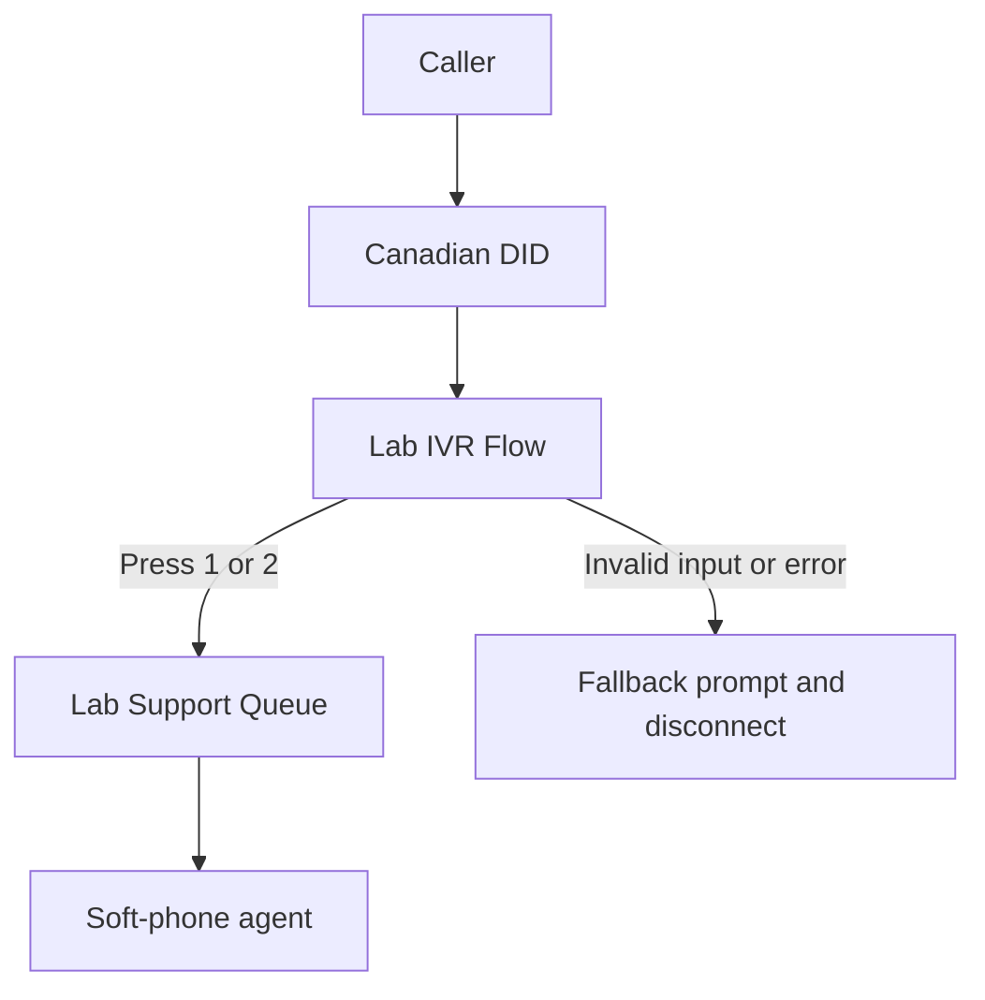

## What I configured

1. I created the `amazon-connect-lab-budget` AWS Budget with a US$5 monthly limit.
2. I configured an actual-cost alert at 20 percent and a forecast alert at 80 percent.
3. I created the `fadli-connect-lab` Amazon Connect instance in Canada Central.
4. I selected Amazon Connect stored users for a simple isolated lab identity model.
5. I enabled inbound calling and configured CloudWatch flow logging.
6. I claimed a Canadian DID and attached it to the published contact flow.
7. I created `Lab Support Queue` with Basic Hours.
8. I created `Lab Support Routing Profile`, enabled Voice, and added the support queue with priority 1 and a delay of 0 seconds.
9. I created a dedicated agent with the Agent security profile, the lab routing profile, and the soft phone.
10. I built and published `Lab IVR Flow` with a greeting, a DTMF menu, options 1 and 2, queue routing, and a fallback path.
11. I signed in as the agent, set the agent status to Available, placed a real inbound call, selected option 1, accepted the contact, and verified two-way audio.
12. I reviewed the completed contact record, real-time queue metrics, historical queue metrics, and CloudWatch flow logs.
13. I released the claimed phone number after testing to stop its daily number charge.

## Cost controls

- I placed the budget guardrail before creating Amazon Connect resources.
- I used a US$5 monthly budget to make unexpected account-level spending visible quickly.
- I configured email alerts at approximately US$1 actual spend and US$4 forecast spend.
- I used one DID only for the live test and released it after validation.
- I kept Customer Profiles, outbound calling, and Amazon Connect email outside the configured voice path.

## Verification results

| Check | Result |
| --- | --- |
| Instance | Amazon Connect displayed the instance as active |
| Routing resources | The queue, routing profile, and agent were created and linked |
| IVR behavior | The call played the greeting and recognized menu options 1 and 2 |
| Queue routing | Option 1 played the technical-support prompt and routed the call to the lab queue |
| Agent handling | The agent accepted the call in the Contact Control Panel and completed two-way audio |
| Contact record | The completed inbound contact showed the queue, agent, and a duration of 1 minute 3 seconds |
| Real-time metrics | The metrics page showed the agent online and available |
| Historical metrics | The queue report showed 100 percent service level at 60 and 120 seconds, 28 seconds average after-contact work, and 41 seconds average agent interaction time |
| CloudWatch | The flow log recorded `Lab IVR Flow`, `GetUserInput`, and the DTMF result `1` |

## Troubleshooting and resolutions

| Situation | Resolution |
| --- | --- |
| The contact-flow canvas connections were unclear during the first build | I traced each success and error branch, connected both menu choices to the queue path, and routed failure branches to the fallback prompt |
| The first historical report showed no records | I expanded the report time range to include the completed test call and the queue metrics populated |

## Evidence

### Cost and service foundation

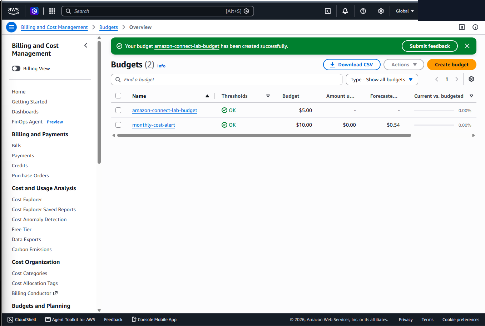

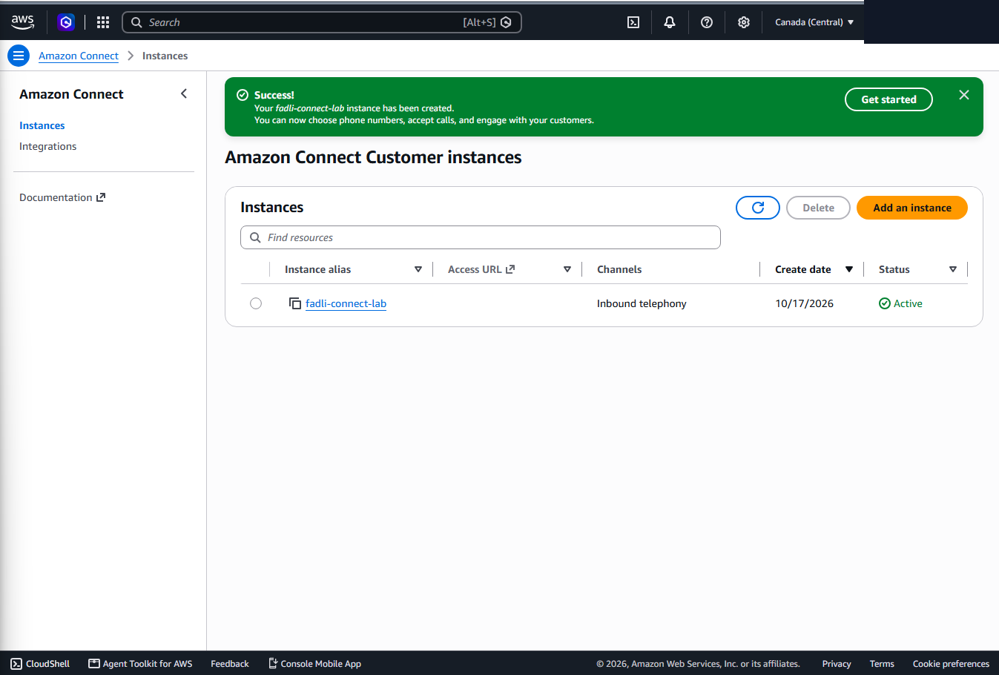

### Routing resources

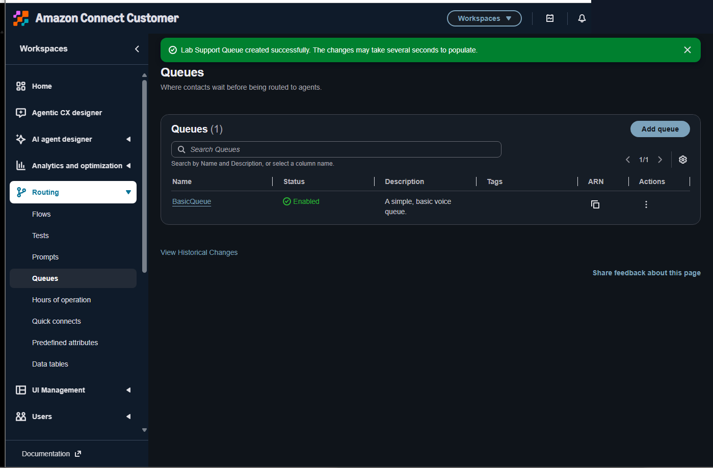

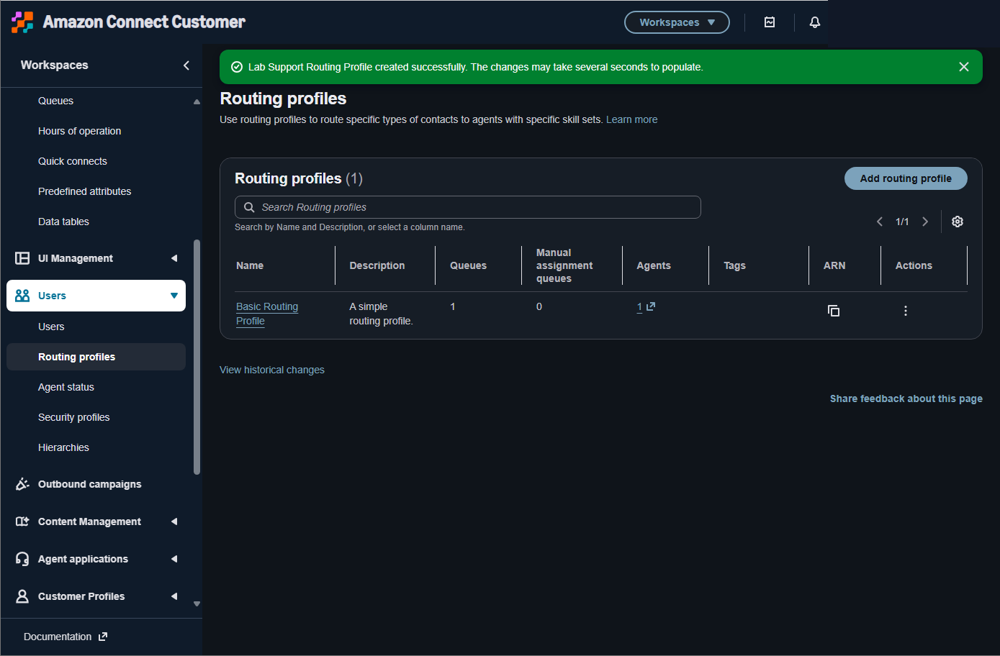

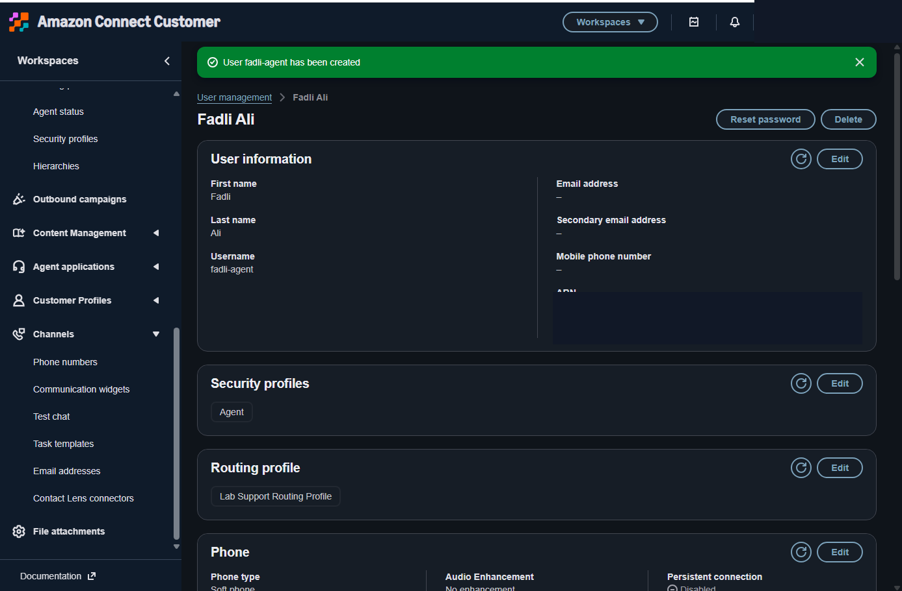

### Contact flow and live test

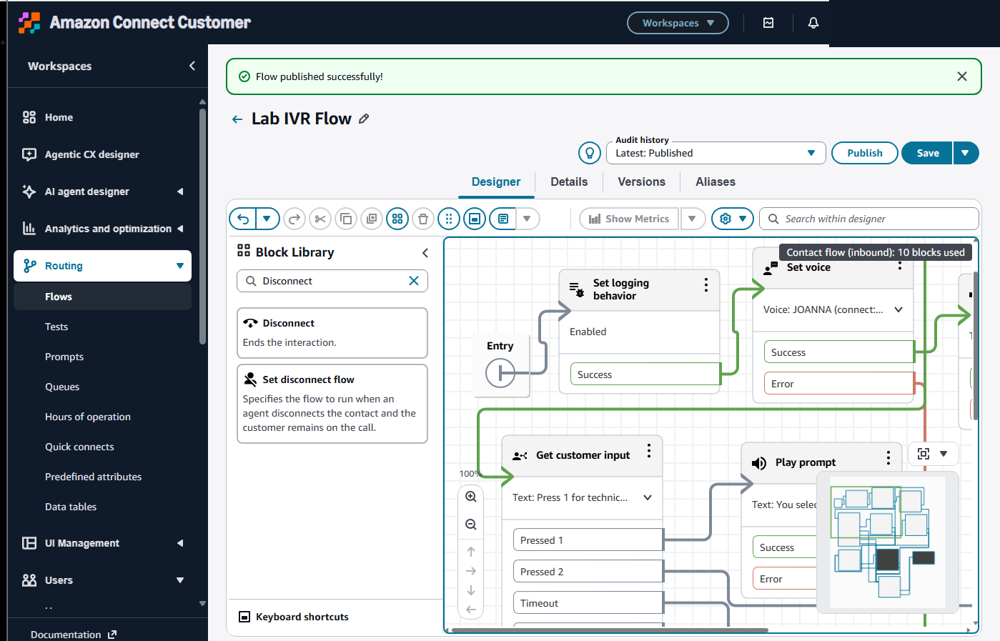

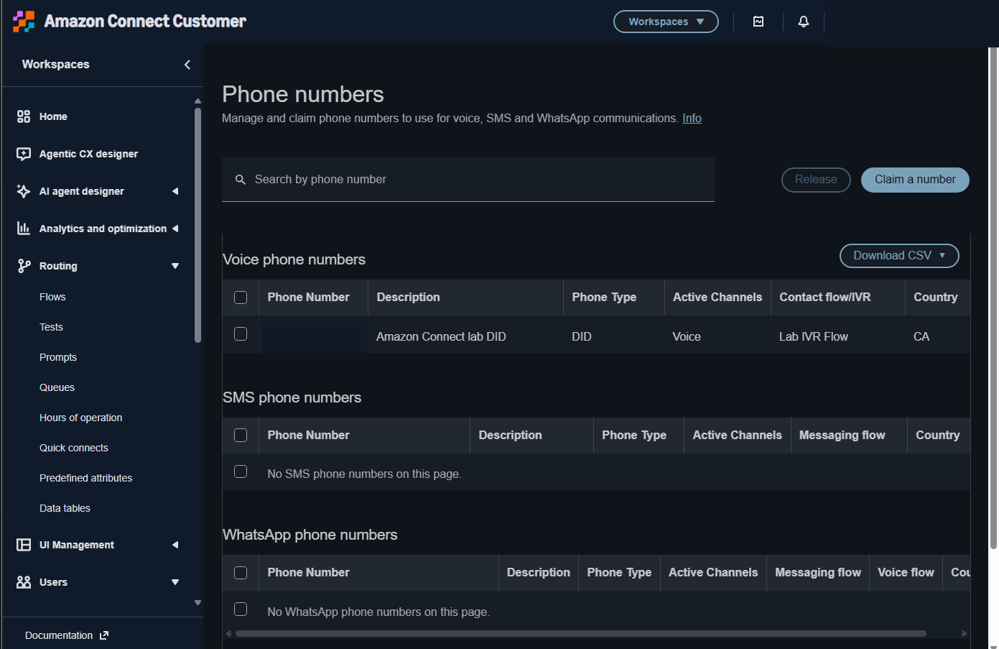

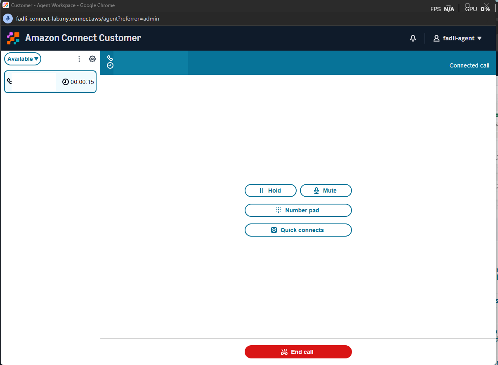

### Monitoring and validation

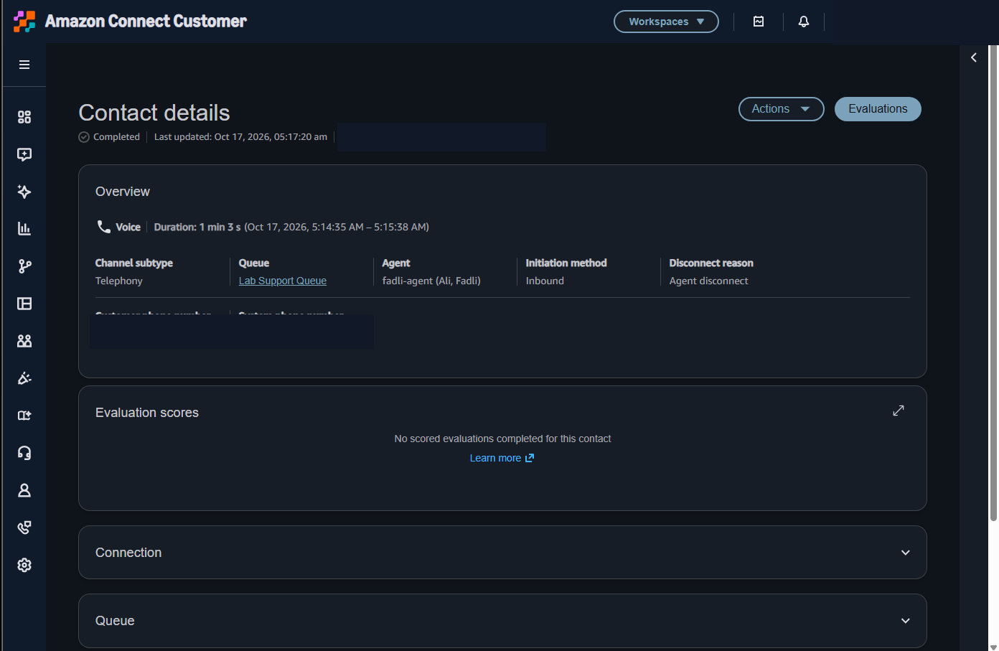

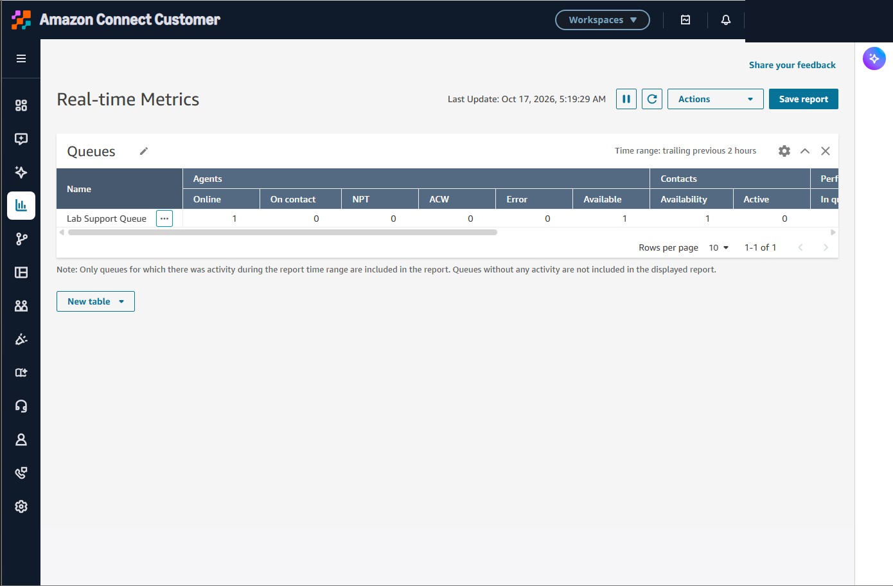

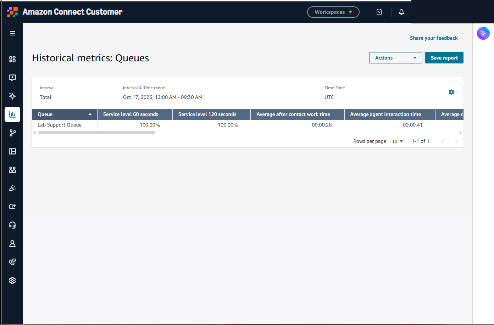

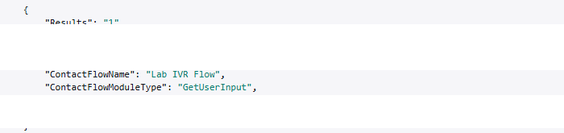

## Skills demonstrated

- AWS Budgets cost monitoring
- Amazon Connect instance and identity configuration
- Queue, routing profile, and agent administration
- Inbound voice and DID association
- Contact-flow and DTMF IVR design
- Contact Control Panel call handling
- Contact record and queue-metric analysis
- CloudWatch log validation
- Resource cleanup and cost awareness

